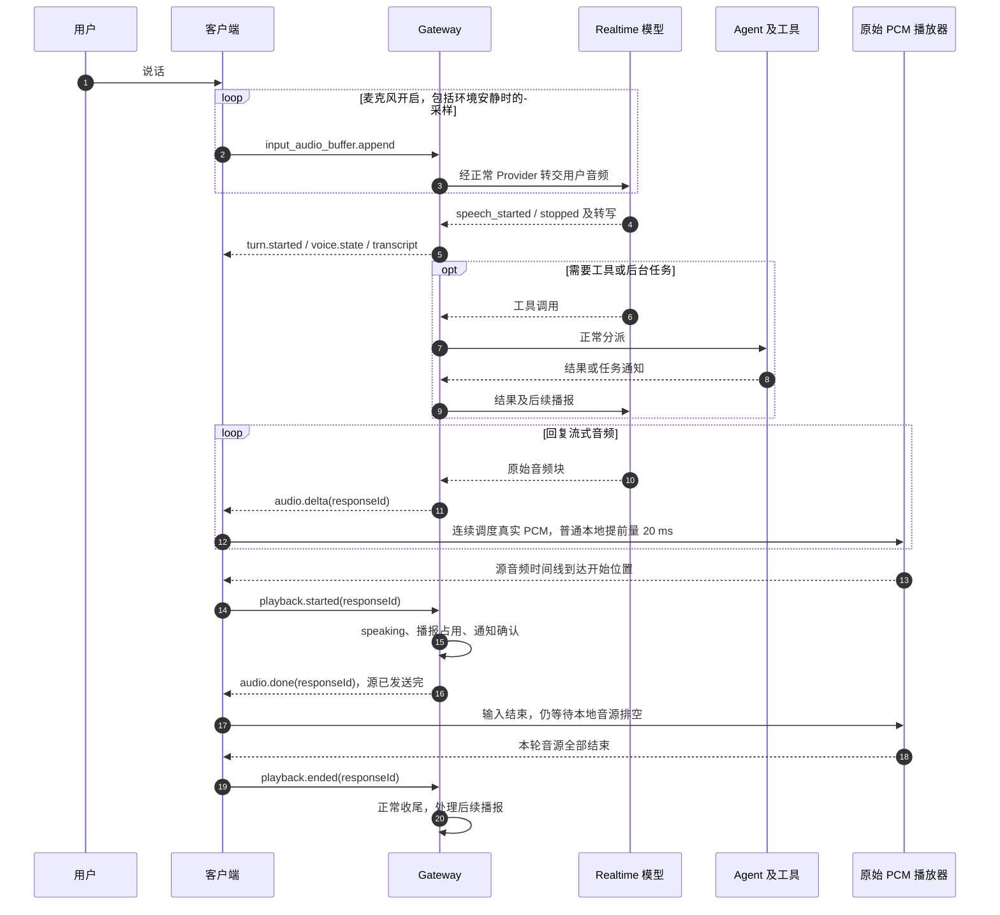
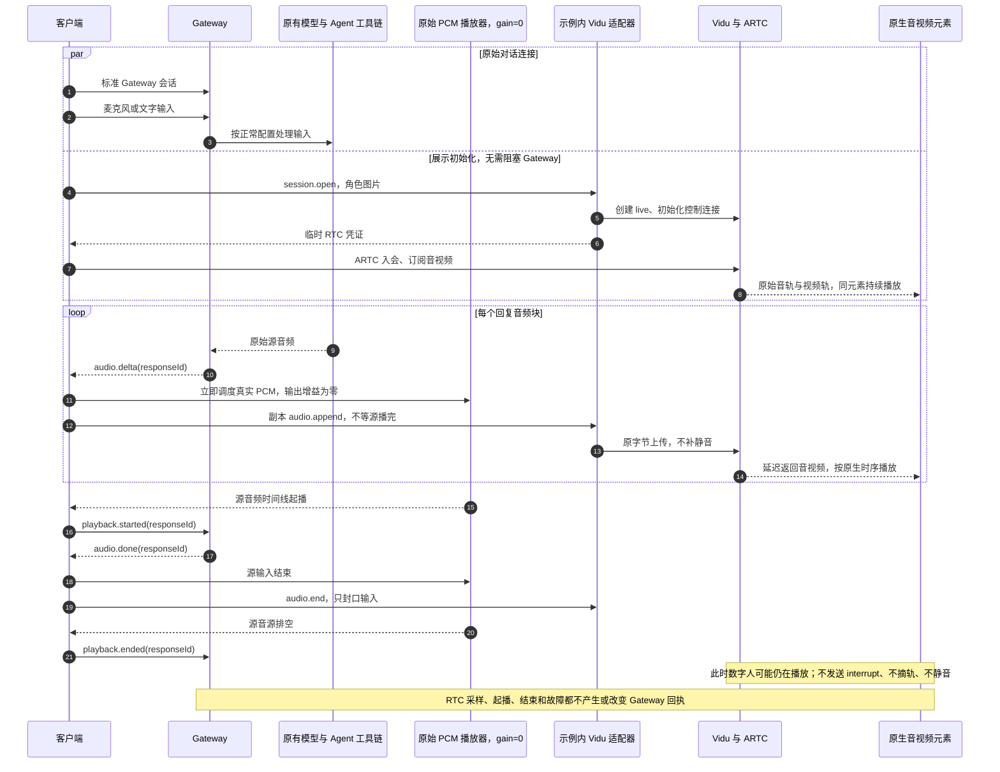
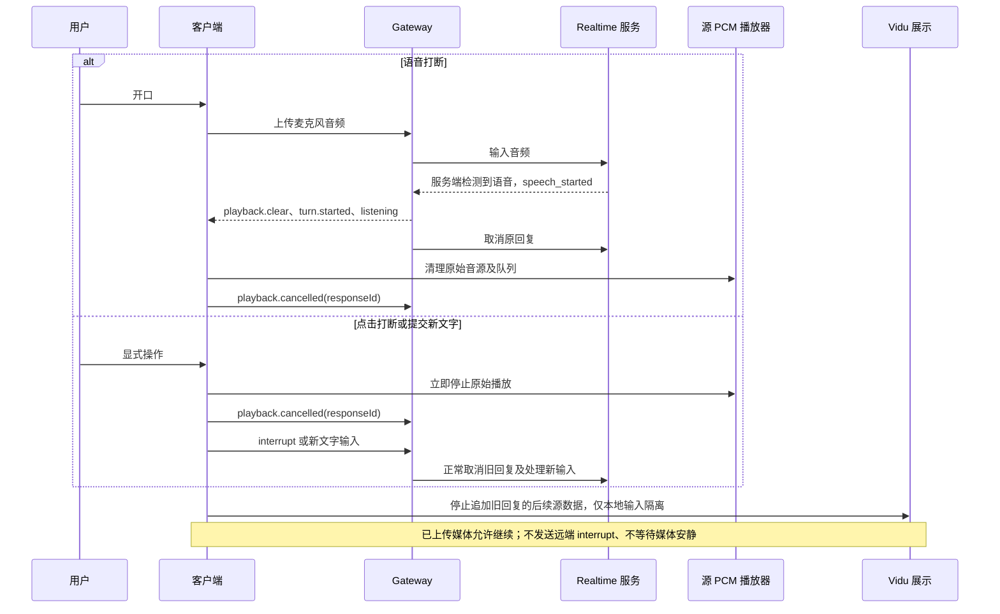
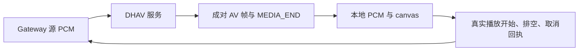

# 原始音频控制与 Vidu 延迟展示流程

[返回总览](../README_ZH.md) · [设计动机与 PR 说明](pr-description.zh.md)

回执是客户端发给 Gateway 的播放状态消息；Gateway 的 `playback.clear` 是反方向的停止指令。
当前 Vidu 回执全部属于原始源音频时间线，不声明数字人已经出声或播完。

## 无数字人的普通本地 PCM 路径

此处描述普通本地 PCM 的核心路径，不包括完整 WebUI 的远程抖动队列、显式静音消费路径、
设备切换等功能。当前示例两种对照模式使用同一份源播放器实现，并未改动内置 WebUI。

## Vidu：原始链路只静音，增加独立展示

原声对照开关仅将源 GainNode 从 0 改为 1，并静音/隐藏原生 RTC 元素；切回时反向交换。
它不修改任何音源、调度位置、回执或 Agent 配置。没有源音频可发送时，不向 Vidu 上传数据；
源 PCM 中已有的静音仍原样发送。厂商内部缓冲不可由客户端等同于等待空档推算。

## 打断：沿用原始判断，数字人不硬切

模型打断判断来自原有 Realtime 服务，客户端不根据 Vidu 音频是否有声作判断。源播放器取消
与 Vidu 的连续输出是刻意分离的。带旧 responseId 的后续源块和旧源音源回调被隔离，但已经
上传的远端媒体不承诺隔离或立即停止。

## 回执会影响哪些原有行为

| 回执或指令 | 方向 | Gateway 行为 |
| --- | --- | --- |
| playback.started | 客户端 → Gateway | speaking、播报占用、条件满足时确认任务通知 |
| playback.ended | 客户端 → Gateway | 正常结束，处理工具后续播报与待播通知 |
| playback.cancelled | 客户端 → Gateway | 取消本轮呈现、清理待发转写；非用户取消的通知可能重试 |
| playback.clear | Gateway → 客户端 | 指令停止原始播放；Gateway 也同步清理自身播放状态 |
| interrupt | 客户端 → Gateway | 取消模型回复及原有回合处理，协议层映射 response.cancel |

因此所有上述回执仍由源音频管理，Vidu 不改变类型、原因或时机。展示错误只提示并回收展示，
不会取消源播放器。用户主动点击结束、新会话或重连属于原有显式会话操作，会清理两条连接。

## DHAV 仍保持真实媒体生命周期

Vidu 不再使用此逐轮真实媒体交付契约。需要维护者认可这种延迟展示范围，不能将其回执描述
为 ARTC 实际播放证明。用户所听位置与模型上下文的差异也仍然存在，示例见 PR 说明。
