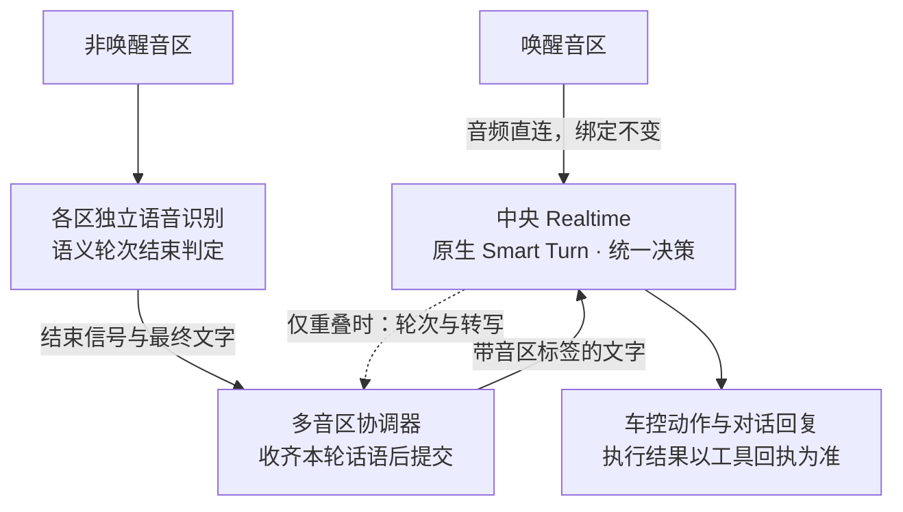

# 多音区交互：唤醒音区与中央 Realtime

中央 Realtime 在本次唤醒会话内固定绑定**唤醒音区**，直接接收该区音频并保留
原生 Smart Turn。其他音区先独立识别，再将带音区标签的文字提交给同一个中央
Realtime；即使只有非唤醒音区说话，也不会改变绑定。

## 设计架构

唤醒区直接对话，其他区先识别；所有请求最终由同一个中央 Realtime 决策。
图中仅展示输入、决策与执行关系，取消旧回复的时序见下方规则。



实线表示请求处理方向；虚线表示唤醒区的轮次与转写事件，供重叠发言时合并。
提交给中央不改变发言者和车控目标：副驾说“打开车窗”仍操作副驾车窗。

**Web Demo 对应关系：**默认主驾为唤醒音区，唯一麦克风直连中央；副驾、左后、
右后通过文字模拟“各区识别完成后的结果”，直接进入协调器。四座均可输入文字，
模拟页只在点击底栏「四音区」后显示，默认及刷新时仍为普通主驾界面。

| 场景 | 处理方式 |
|---|---|
| 只有唤醒音区说话 | 音频直通中央，原生 Smart Turn 自动回复与调用工具 |
| 只有非唤醒音区说话 | 识别结束后带标签提交中央，独立开轮，不等待唤醒区发言 |
| 多个非唤醒音区说话 | 等各参与区结束与最终识别，合并提交中央 |
| 唤醒区与其他音区重叠 | 保持唤醒区音频直连，拦住旧输出与执行，收齐后合并提交中央 |

## 轮次与执行规则

1. 非唤醒音区参与时开启收集屏障，取消已有回复、清空播放并阻止旧工具执行。
   唤醒区仍在发言时继续发送音频，让原生 Smart Turn 自行结束；自动回复尚未
   出现则在 `response.created` 后取消，并等待对应 `response.done`。
2. 只等本批参与者的结束信号和最终文字；进入收集后不因人数减少提前提交。
   Web 使用 300ms 接话窗口，等待上限 30 秒；超时或识别失败整批取消，
   `turn_invalid` 发言丢弃。批次提交后的新发言进入下一轮。
3. `response.cancel` 不结束输入轮次，也不能撤销已发出的车控动作。
   不能只凭 ASR final、固定静音或取消请求认定 Smart Turn 已结束。
   非唤醒区需要独立的语义结束能力，并支持“我也要”这类省略句。
4. 合并为一条普通用户消息，保留音区和服务端记录的发言顺序；同次 Web 文字
   提交按页面座位顺序排列。例如：

```text
【主驾】打开车窗
【副驾】我也要
```

中央统一理解后分别操作主副驾车窗。“我也要”由模型结合本批及历史成功请求
理解；显式位置优先，未指定位置按发言者归属。跨轮接话只补做接话者的操作，
冲突不明确时追问，以实际工具回执说明结果。左后、右后共享后排温区。

## 使用与实现边界

运行 `npm run example:smart-cockpit`，打开 `http://localhost:5173`。
点击「发送本轮输入」提交非空文字；其他三区可独立发送，也可加入主驾发言。
编辑草稿或载入示例不会打断回复；切换页面保留中央连接、Smart Turn 和车辆状态。

当前代码已符合“主驾固定唤醒绑定 + 其他区文字提交中央”的 Web 路由。
实车仍需接入多路收音、音区归属、缓存及非唤醒区 ASR/语义轮次检测。
现有输入和同轮工具调用有防重，跨轮动作幂等仍需补齐；Web 切页确认期间
尚无音频缓存，可能短暂丢帧。当前不提供实车唤醒检测或唤醒音区切换。

代码入口：[事件装配](../gateway/multi-zone/events.mjs)、
[唤醒区 Smart Turn 观察器](../gateway/multi-zone/smart-turn.mjs)、
[协调器](../gateway/multi-zone/coordinator.mjs)、
[音区工具规则](../gateway/multi-zone/policy.mjs)、
[Web 输入路由](../client/src/projections/multi-zone-input.js)。

## 验证

```bash
node --test examples/smart-cockpit/gateway/test/multi-zone.test.mjs examples/smart-cockpit/client/test/multi-zone-input.test.mjs server/test/realtime-session-runtime.test.mjs server/test/realtime-provider.test.mjs
npm run example:smart-cockpit:build
npm run example:smart-cockpit:lint
```

真实模型验收使用独立座舱，见 [验收脚本](../bench/runner/run-multi-zone.mjs)；
通过 `COCKPIT_VALIDATION_PCM` 可加入主驾语音与其他区文字的重叠测试。

协议参考：[Smart Turn 与取消约束](https://help.aliyun.com/zh/model-studio/audio-realtime-websocket-access)。
